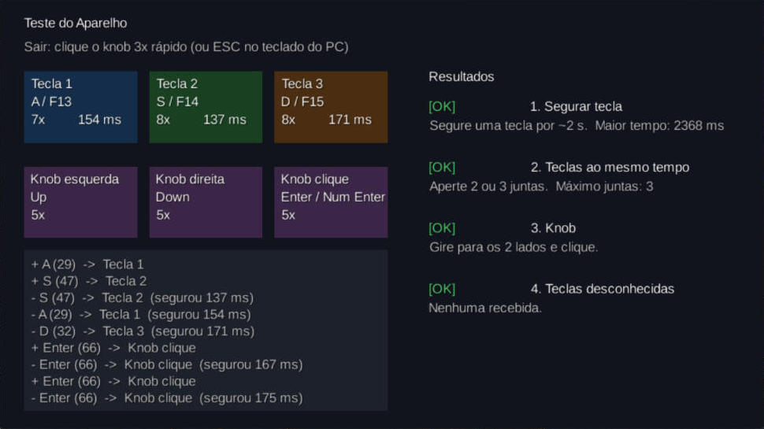

# Teste do aparelho (fazer quando o teclado chegar)

Tempo estimado: **30 minutos**. Objetivo: configurar o teclado de 3 teclas + knob e confirmar que ele faz tudo que o jogo precisa.

## 1. Ver o que ele faz de fábrica

1. Conecte o aparelho no PC pelo cabo USB.
2. Abra o Bloco de Notas e aperte cada tecla e gire/clique o knob.
3. Anote o que aconteceu (ex.: "Tecla 1 escreveu `a`", "knob mudou o volume do PC").

## 2. Configurar as teclas

**De fábrica, as 3 teclas e o knob (girar e apertar) enviam a letra `C`.** Por isso é preciso configurar antes de jogar.

A configuração fica **salva no próprio aparelho**: depois de configurar uma vez, ele funciona em qualquer PC (Windows, Linux, macOS), sem o programa.

### 2.1 Baixar e abrir o programa (só Windows)

1. Baixe o programa pelo QR code do manual ou pelo link reserva: `http://www.szxiaozi.com/t1.zip`.
2. Descompacte e rode **`MINI KeyBoard.exe`**. O Windows/antivírus pode avisar que o programa é desconhecido; o manual diz para ignorar. Se quiser, verifique o arquivo antes no [VirusTotal](https://www.virustotal.com/).
3. Conecte o aparelho. O topo da janela deve mostrar **Connected** em verde. Se der erro, troque de porta USB.
4. Deixe marcado **Layer1** (no topo).

### 2.2 Configurar cada botão

Para cada linha da tabela: **clique no botão** na janela (ele fica vermelho) → na parte de baixo, na aba **KEY**, **clique na tecla** → confira que o campo da direita mostra **só** essa tecla → clique em **Download**.

| Botão físico | Na janela do programa | Tecla a escolher (aba **KEY**) |
|---|---|---|
| Tecla 1 (esquerda) | `KEY1` | `A` |
| Tecla 2 (meio) | `KEY2` | `S` |
| Tecla 3 (direita) | `KEY3` | `D` |
| Knob girar para a esquerda (anti-horário) | `K1 Left` | Seta para cima `↑` |
| Knob apertar | `K1 Centre` | `Enter` |
| Knob girar para a direita (horário) | `K1 Right` | Seta para baixo `↓` |

Cuidados:
- O programa mostra `KEY1`…`KEY16` e `K1`…`K3` porque serve para vários modelos. Só usamos `KEY1`–`KEY3` e `K1`.
- **Não use a aba Multimedia** (Volume+, Play/Pause…): o jogo não consegue ler essas teclas.
- Cada clique numa tecla **soma** ela ao campo em vez de trocar. Se o campo mostrar mais de uma tecla (ex.: `F S`, ou `Ctrl` junto), clique em **Cancel**, selecione o botão de novo e escolha só a tecla certa.
- Se a aba KEY tiver `F13`, `F14` e `F15`, pode usá-las nas teclas 1–3 no lugar de A/S/D (o jogo aceita as duas).
- Opcional: na aba de LED, o modo 0 apaga as luzes.

### 2.3 Conferir no Bloco de Notas

Teclas 1, 2 e 3 escrevem `a`, `s`, `d`; girar o knob sobe/desce o cursor; apertar o knob pula linha.

## 3. Rodar a tela de teste do jogo

1. Abra o TrioTiles (veja "Como rodar" no [README](../README.md)).
2. No menu, gire o knob até **Teste do Aparelho** e clique.
3. Faça os testes abaixo. A coluna **Resultados** da tela muda sozinha para `OK` ou `PROBLEMA`.

| # | Teste | Como fazer | Se der problema |
|---|---|---|---|
| 1 | **Segurar tecla** | Segure cada tecla por uns 2 segundos e veja o tempo em "ms" | Se o tempo fica sempre perto de 0 ms mesmo segurando, o aparelho "solta sozinho". Nesse caso **não teremos notas longas** e trocamos por toques repetidos (ver PROPOSTA, seção 9) |
| 2 | **Teclas ao mesmo tempo** | Aperte 2 teclas juntas, depois as 3 | Se "Máximo juntas" não passa de 1, não teremos acordes na Fase 3 |
| 3 | **Knob** | Gire para os dois lados e clique | Se nada aparece na tela e o volume do PC muda, o knob ainda está em modo "mídia": volte ao passo 2 |
| 4 | **Teclas desconhecidas** | Use todos os botões | Se aparecer "tecla NÃO configurada", o log mostra qual tecla o aparelho enviou. Reconfigure o aparelho ou adicione essa tecla em `DeviceMapping.standard()` |

Para sair da tela de teste: **clique o knob 3 vezes rápido** (ou `Esc` no teclado do PC).

## 4. Registrar o resultado

Preencha e faça commit desta tabela (é material para o Kanban e para o short paper):

| Teste | Resultado | Observação |
|---|---|---|
| Configuração de fábrica | Todas as teclas e o knob enviam `C` | Normal para este modelo |
| Programa do fabricante funcionou? | ✅ Sim | `MINI KeyBoard V02.1.1` no Windows 11, mostrou **Connected** na hora |
| 1. Segurar tecla | ✅ OK | Maior tempo segurando: **2368 ms**. No Bloco de Notas, segurar repete a letra. **Notas longas viáveis** |
| 2. Teclas ao mesmo tempo (máximo) | ✅ OK, **3** | As 3 teclas juntas funcionam. **Acordes viáveis** |
| 3. Knob | ✅ OK | Girar para os 2 lados e clicar funcionam; clique segurado também mantém a tecla |
| 4. Teclas desconhecidas | ✅ OK | Nenhuma recebida |
| Teclas usadas no final (A/S/D ou F13/F14/F15) | `A` / `S` / `D`, knob `↑` / `Enter` / `↓` | Tudo na Layer1 |

Testado em 22/10/2026.

> **Atenção ao configurar de novo:** no programa, cada clique numa tecla **soma** ela ao campo (ex.: `F S`), em vez de trocar. Se errar, clique em **Cancel**, selecione o botão de novo e escolha só a tecla certa antes do **Download**.
