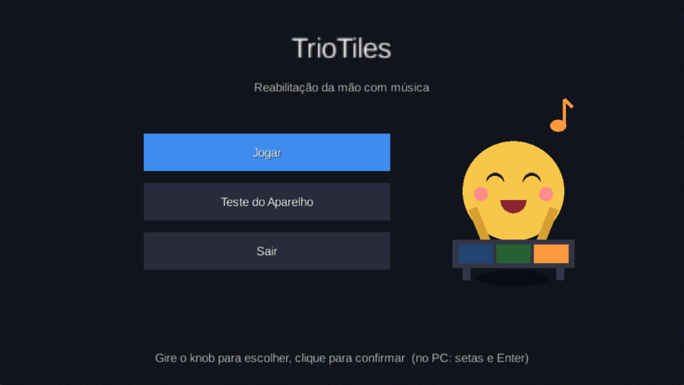

# TrioTiles

Jogo sério de reabilitação da mão e dos dedos, no estilo *Piano Tiles*, feito em **libGDX** e controlado só por um mini teclado USB de **3 teclas + 1 knob**. Notas caem em 3 trilhas e cada dedo toca a sua tecla; o jogo mede velocidade e consistência dos toques e mostra a evolução do paciente sessão a sessão.

- Projeto (problema, justificativa, mecânicas, requisitos): [docs/PROPOSTA.md](docs/PROPOSTA.md)
- Short paper: [docs/short-paper](docs/short-paper/)
- Configurar e testar o aparelho: [docs/APARELHO.md](docs/APARELHO.md)

**Equipe** (Universidade Presbiteriana Mackenzie, disciplina Jogos Digitais): Matheus Santiago de Brito, Lucas Hiroyuki Omine e Leonardo Guedes Serra de Sant'Ana.



## Jogar

Baixe o **`TrioTiles-windows.zip`** (GitHub → *Actions* → execução mais recente → *Artifacts* → **TrioTiles-windows**), descompacte e abra **`TrioTiles.exe`**. Não precisa instalar Java. Se o Windows avisar que o programa é desconhecido: **Mais informações → Executar assim mesmo**.

## Rodar o código

Precisa do **JDK 17+**. Coloque o projeto numa pasta **sem acento** no caminho (ex.: `C:\dev\TrioTiles`).

- **VS Code** (Extension Pack for Java): abra a pasta e clique em **Run** no `main` de `lwjgl3/src/main/java/io/github/triotiles/lwjgl3/Lwjgl3Launcher.java`.
- **Terminal:** `gradlew.bat lwjgl3:run` (Linux/macOS: `sh gradlew lwjgl3:run`).
- **Gerar o executável:** `gradlew.bat lwjgl3:packageWindows` → `lwjgl3/build/dist/TrioTiles-windows.zip`. O `.jar` sai com `gradlew.bat lwjgl3:jar` em `lwjgl3/build/libs/`.

> Erro `Could not find or load main class ...Lwjgl3Launcher` no VS Code: tire o acento do caminho da pasta, faça `Ctrl+Shift+P` → **Java: Clean Java Language Server Workspace** e rode de novo.

## Controles

| Aparelho | No jogo | Teclado do PC |
|---|---|---|
| Teclas 1 / 2 / 3 | Trilhas esquerda / meio / direita | `A` / `S` / `D` |
| Girar o knob ← / → | Navegar · notas de giro (Fase 3) | `↑` / `↓` |
| Clicar o knob | Confirmar · pausar | `Enter` |

## Dados do paciente

- Histórico de sessões: `%USERPROFILE%\TrioTiles\historico.json` e `historico.csv` (abre no Excel).
- Progresso e configurações: `%USERPROFILE%\.prefs\TrioTiles` e `TrioTiles-config`.

## Estrutura

```
core/     jogo (input, game, audio, save, screens)
lwjgl3/   versão desktop e empacotamento do .exe
assets/   sons
docs/     projeto, short paper, aparelho e prints
```

Ao enviar o projeto para outro repositório, envie também `.github/`, `.gitattributes`, `gradlew`, `gradlew.bat` e `gradle/wrapper/` (com o `.jar`): é o que faz o GitHub Actions gerar o `.exe` e o `.jar`.
