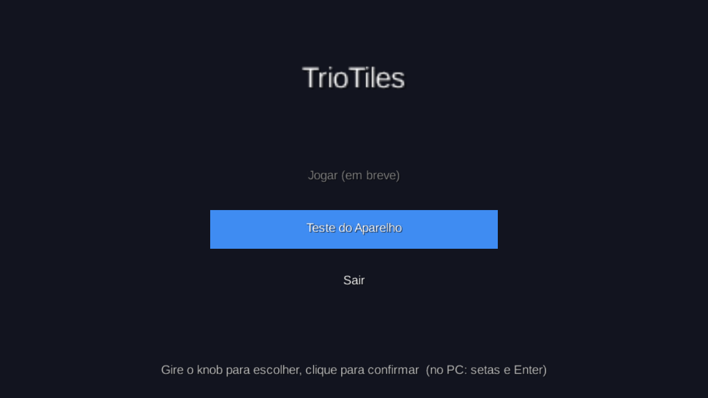

# TrioTiles

Jogo sério de reabilitação da mão e dos dedos, no estilo *Piano Tiles*, feito em **libGDX** e controlado por um teclado USB de **3 teclas + 1 knob**.

- Proposta, encaixe na reabilitação e roadmap: [docs/PROPOSTA.md](docs/PROPOSTA.md)
- Guia para testar o aparelho: [docs/TESTE_APARELHO.md](docs/TESTE_APARELHO.md)
- Levar o projeto (.zip) para outro repositório, como o da entrega: [docs/ENTREGA.md](docs/ENTREGA.md)

**Status:** Sprints 0, 1 e 2 concluídas (aparelho testado, fase jogável, pontuação e métricas de velocidade e consistência). Próximo: Sprint 3, menus e personagem.

Funciona baixando o `.zip` do GitHub, em qualquer pasta (inclusive com acento, como `Temporário`) e em qualquer repositório, mesmo enviando os arquivos pelo site.



## Como rodar

Precisa do **JDK 17 ou mais novo** (ex.: [Temurin](https://adoptium.net/)). O Gradle é baixado sozinho na primeira vez.

```bash
# Windows
gradlew.bat lwjgl3:run

# Linux / macOS (o "sh" evita erro de permissão em projetos vindos de .zip)
sh gradlew lwjgl3:run
```

No IntelliJ IDEA: *File → Open* na pasta do projeto e rode a tarefa Gradle `lwjgl3 > application > run`.

### Gerar o executável (.jar)

```bash
gradlew.bat lwjgl3:jar        # Linux / macOS: sh gradlew lwjgl3:jar
java -jar lwjgl3/build/libs/TrioTiles-0.1.0.jar
```

Cada push no GitHub também gera o `.jar` automaticamente: aba **Actions** → execução mais recente → artefato **TrioTiles-jar**.

### Rodar os testes

```bash
gradlew.bat test              # Linux / macOS: sh gradlew test
```

## Controles

O jogo é controlado só pelo aparelho. Enquanto ele não está disponível, o teclado do PC simula:

| Aparelho | Ação | Teclado do PC |
|---|---|---|
| Tecla 1 / 2 / 3 | Trilhas esquerda / meio / direita | `A` / `S` / `D` (ou `F13`/`F14`/`F15`) |
| Knob girar ← / → | Navegar nos menus · na pausa, voltar ao menu | `↑` / `↓` |
| Knob clique | Confirmar · pausar e continuar o jogo | `Enter` |

## Estrutura

```
core/     lógica do jogo (independente de plataforma)
  input/    leitura do aparelho: DeviceInput, DeviceMapping, DeviceAction
  game/     regras, sem desenho: Note, Chart (sequência de notas), Playfield (acerto/erro),
            Judge (Perfeito/Bom/Ok), Score (pontos e combo), SessionStats (métricas da sessão)
  screens/  telas: MenuScreen, GameScreen, ResultScreen, DeviceTestScreen
lwjgl3/   versão desktop (Lwjgl3Launcher)
assets/   imagens, sons e fontes
docs/     proposta, guias e prints
```

O resto do jogo nunca lê teclas diretamente: só recebe ações como "Tecla 2 pressionada" da classe `DeviceInput`. Se o mapeamento do aparelho mudar, só `DeviceMapping` muda.
