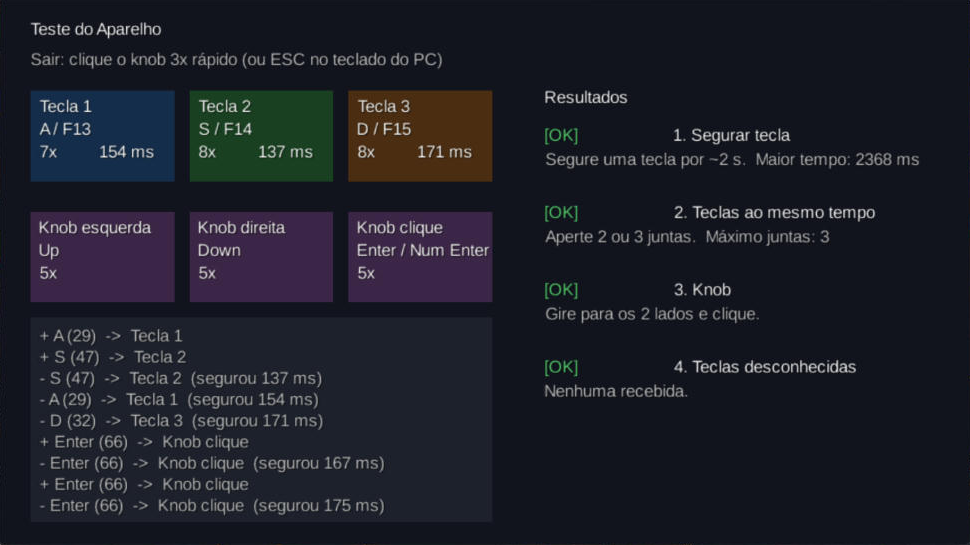

# Aparelho: configuração e teste

Mini teclado USB-C de 3 teclas + 1 knob. De fábrica, **todos os botões enviam a letra `C`**; é preciso configurar uma vez. A configuração fica salva no aparelho e vale em qualquer computador.

## Configurar (só Windows, 5 min)

1. Baixe o programa do manual (QR code ou `http://www.szxiaozi.com/t1.zip`), descompacte e abra `MINI KeyBoard.exe` com o aparelho conectado. O topo deve mostrar **Connected**.
2. Deixe **Layer1** marcado. Para cada linha: clique no botão da janela, escolha a tecla na aba **KEY** e clique em **Download**.

| Botão físico | Na janela | Tecla |
|---|---|---|
| Tecla 1 | `KEY1` | `A` |
| Tecla 2 | `KEY2` | `S` |
| Tecla 3 | `KEY3` | `D` |
| Knob para a esquerda | `K1 Left` | `↑` |
| Knob clique | `K1 Centre` | `Enter` |
| Knob para a direita | `K1 Right` | `↓` |

> Cada clique numa tecla **soma** ela ao campo. Se o campo mostrar mais de uma (ex.: `F S`), clique em **Cancel** e escolha de novo. Não use a aba *Multimedia*: o jogo não lê teclas de volume.

## Testar

No jogo: **Menu → Teste do Aparelho**. Os quatro itens devem ficar `OK`: segurar tecla (mais de 1000 ms), teclas ao mesmo tempo (até 3), knob (dois lados e clique) e nenhuma tecla desconhecida. Para sair, clique o knob 3 vezes rápido.

Resultado com o nosso aparelho (22/10/2026): **4/4 OK**. Ele segura a tecla (2368 ms), aceita as 3 teclas juntas e o knob envia teclas normais.

