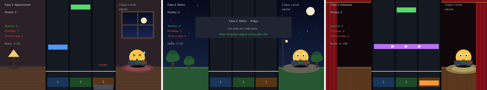
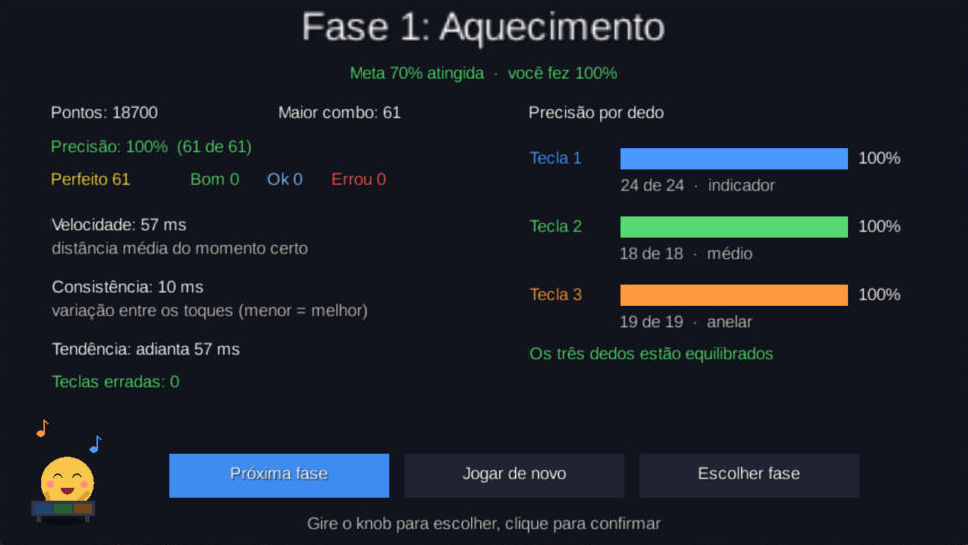
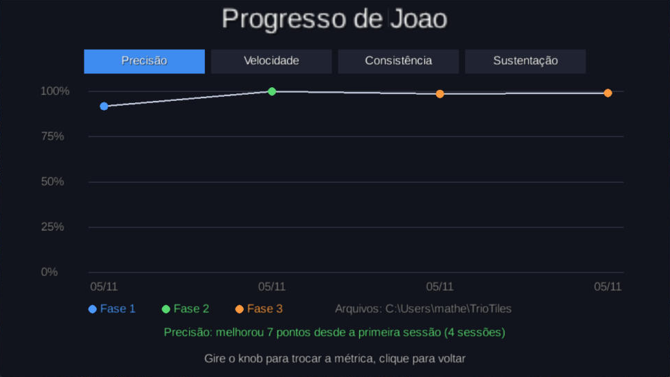

# TrioTiles: projeto

Jogo sério de reabilitação da **mão e dos dedos**, no estilo *Piano Tiles*, feito em **libGDX** e controlado só por um mini teclado USB de **3 teclas + 1 knob** (dispositivo aprovado pelo professor). O personagem principal é o **Pipo**. O texto completo está no [short paper](short-paper/TrioTiles_ShortPaper.pdf).

**Equipe** (Universidade Presbiteriana Mackenzie, disciplina Jogos Digitais): Matheus Santiago de Brito, Lucas Hiroyuki Omine e Leonardo Guedes Serra de Sant'Ana.

## 1. Ideia

Notas caem em 3 trilhas e o paciente aperta a tecla da trilha certa no momento certo, **um dedo em cada tecla**. O knob navega nos menus, pausa o jogo e, na Fase 3, vira mecânica (notas de giro). Cada toque gera dados (quando apertou, quanto tempo segurou, para que lado girou) que viram a pontuação **e** o histórico de evolução do paciente.

## 2. Dispositivo

Mini teclado USB-C reconhecido como teclado comum (HID), configurado uma vez no programa do fabricante (passo a passo em [APARELHO.md](APARELHO.md)):

| Botão | Tecla enviada | No jogo |
|---|---|---|
| Tecla 1 / 2 / 3 | `A` / `S` / `D` | Trilhas esquerda / meio / direita |
| Knob ← / → | `↑` / `↓` | Menus · notas de giro |
| Knob clique | `Enter` | Confirmar · pausar |

O jogo inteiro (menus, pausa, reinício e jogo) funciona **só com o aparelho**. Ele é o sensor do exercício: mede qual dedo apertou, quando, quanto tempo segurou e para que lado girou.

## 3. Problema de reabilitação

Função motora fina da mão: pessoas **pós-AVC** (destreza e individuação dos dedos), recuperação de **lesões ou cirurgias de mão/punho**, **Parkinson** e idosos. É uma ferramenta de apoio, para uso com orientação de fisioterapeuta ou terapeuta ocupacional.

| Capacidade | Como o jogo exige |
|---|---|
| Individuação dos dedos | Cada dedo tem sua tecla; apertar sem nota conta como "tecla errada" |
| Tempo de reação | Apertar quando a nota cruza a linha de acerto |
| Ritmo e consistência | Notas em ritmo constante; o jogo mede a variação do tempo |
| Força e resistência | Notas longas: segurar a tecla até o fim |
| Coordenação entre dedos | Acordes: duas teclas juntas |
| Rotação fina (pinça e punho) | Notas de giro do knob |

## 4. Justificativa

Repetição sem tédio (centenas de toques viram "uma música"), feedback imediato a cada toque, progressão gradual de carga (3 fases e metas), motivação (pontos, combo, personagem, fases liberadas) e **dados objetivos** para o terapeuta. A ideia segue a linha da *Music-Supported Therapy*, em que pacientes pós-AVC treinam tocando instrumentos (Schneider et al., 2007).

## 5. Jogo

**Fases** (a seguinte libera ao atingir a meta da anterior):

| | Fase 1: Aquecimento | Fase 2: Ritmo | Fase 3: Destreza |
|---|---|---|---|
| Cenário | Quarto | Praça | Teatro |
| Duração · notas | ~1 min · ~60 | ~1,5 min · ~95 | ~2 min · ~185 |
| Janela de acerto | ±300 ms | ±250 ms | ±200 ms |
| Tipos de nota | simples | + longas | + longas, acordes e giros |
| Meta | 70% de precisão | 75% de precisão | concluir |



**Pipo:** músico atrás de um tecladinho igual ao do paciente. Pula e toca a tecla acertada, faz "ops" no erro (sem punir), dança a partir de 10 acertos seguidos e comemora no resultado acima de 70%.

**Menus pelo knob:** Jogar (seleção de fase) · Progresso · Configurações · Teste do Aparelho · Sair. Na fase, o clique abre a pausa: Continuar · Reiniciar fase · Voltar ao menu.

**Pontuação:** cada toque é avaliado pelo erro de tempo Δt (toque − momento ideal): **Perfeito** ≤ 80 ms (100 pts), **Bom** ≤ 160 ms (70), **Ok** ≤ 250 ms (40), na Fase 2. Os pontos são multiplicados pelo combo (até 4x); nota perdida ou tecla errada zera o combo.

**Métricas de reabilitação** (salvas a cada sessão e mostradas no gráfico de Progresso):

| Métrica | Cálculo |
|---|---|
| Precisão | acertos ÷ notas (geral e por dedo) |
| Velocidade | média de \|Δt\| (ms) |
| Consistência | desvio padrão de Δt (ms) |
| Tendência | média de Δt: adianta ou atrasa |
| Sustentação | % do tempo das notas longas que foi segurado |
| Teclas erradas | toques sem nota, por dedo |

| Resultado da fase | Progresso do paciente |
|---|---|
|  |  |

**Configurações:** paciente (digitado com o aparelho), mão usada (nome do dedo em cada tecla), velocidade, janela de acerto, volume e ajuste de atraso (com sugestão pelo histórico).

## 6. Requisitos do enunciado

| Requisito | Atendido por |
|---|---|
| libGDX | Projeto Java 17 + libGDX 1.14.2 (gdx-liftoff) |
| Controle exclusivo pelo dispositivo | 3 teclas + knob em todas as telas |
| Ações influenciadas pelo uso do dispositivo | Qual dedo, quando, quanto tempo e para que lado gira |
| 3 fases com dificuldade progressiva | Aquecimento → Ritmo → Destreza |
| Personagem principal | Pipo |
| Menu: iniciar, pausar, reiniciar | Menu principal + pausa (Continuar / Reiniciar / Menu) |
| Velocidade e consistência como pontuação | Perfeito/Bom/Ok pelo Δt e combo; velocidade e consistência no resultado |
| Métrica de evolução do paciente | Histórico por paciente + tela de Progresso |
| Executável | `TrioTiles.exe` (Java embutido) e `.jar` |
| Short paper (até 6 páginas) | [docs/short-paper](short-paper/) |
| Commits semanais + Kanban | Sprints semanais abaixo; Kanban no repositório da entrega |

## 7. Arquitetura

```
core/   (independente de plataforma)
  input/   DeviceInput, DeviceMapping, DeviceAction: o jogo só vê "ações", nunca teclas
  game/    regras sem desenho: Note, Chart, Playfield, Judge, Score, SessionStats,
           LevelData, Progress, Pipo, Settings, SessionRecord, SessionHistory
  audio/   Sfx
  save/    ProgressStore, SettingsStore, HistoryStore
  screens/ Menu, LevelSelect, Game, Result, Progress, Settings, NameEdit, DeviceTest,
           PipoRenderer, StageRenderer, OptionList
lwjgl3/ versão desktop (Lwjgl3Launcher, StartupHelper) e empacotamento do .exe
```

## 8. Roadmap (sprints semanais)

| Sprint | Entrega | Data |
|---|---|---|
| 0 | Proposta aprovada, projeto libGDX + CI, aparelho configurado e testado | 22/10 |
| 1 | Núcleo: 3 trilhas, notas caindo, acerto/erro | 22/10 |
| 2 | Perfeito/Bom/Ok, pontos, combo, métricas e tela de resultado | 28/10 |
| 3 | Menus e pausa pelo knob, Pipo e sons | 30/10 |
| 4 | 3 fases, notas longas, acordes, giros, cenários e desbloqueio | 01/11 |
| 5 | Histórico por paciente (JSON/CSV), gráfico de Progresso, Configurações | 04/11 |
| 6 | Executável `.exe` e teste completo com o aparelho | 05/11 |
| 7 | Short paper, prints finais e limpeza do repositório | 05/11 |
