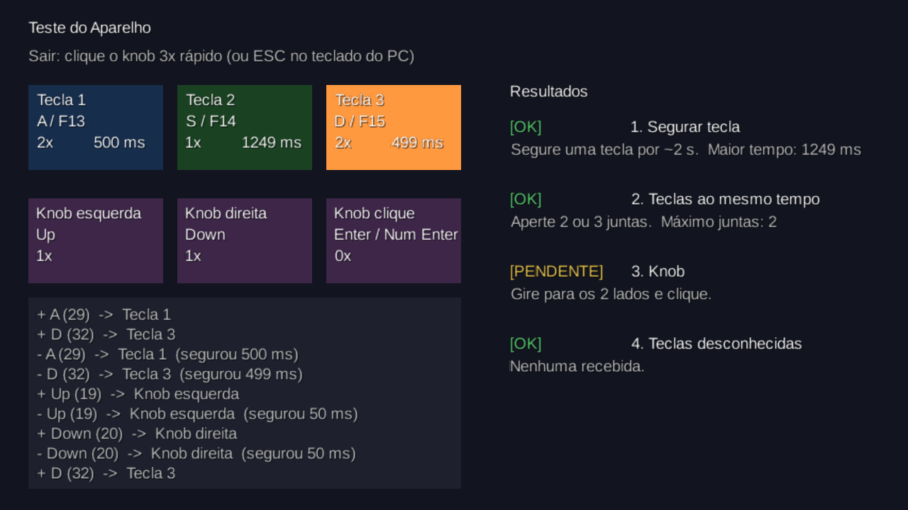

# Teste do aparelho (fazer quando o teclado chegar)

Tempo estimado: **30 minutos**. Objetivo: configurar o teclado de 3 teclas + knob e confirmar que ele faz tudo que o jogo precisa.

## 1. Ver o que ele faz de fábrica

1. Conecte o aparelho no PC pelo cabo USB.
2. Abra o Bloco de Notas e aperte cada tecla e gire/clique o knob.
3. Anote o que aconteceu (ex.: "Tecla 1 escreveu `a`", "knob mudou o volume do PC").

## 2. Configurar as teclas

O aparelho é configurado por um programa do fabricante (geralmente só para Windows). O link costuma estar na página do produto ou é enviado pelo vendedor. A configuração fica **salva no próprio aparelho**: depois de configurar uma vez, ele funciona em qualquer PC.

Configure assim:

| Botão físico | Enviar a tecla |
|---|---|
| Tecla 1 (esquerda) | `A` |
| Tecla 2 (meio) | `S` |
| Tecla 3 (direita) | `D` |
| Knob girar para a esquerda | Seta para cima `↑` |
| Knob girar para a direita | Seta para baixo `↓` |
| Knob clique | `Enter` |

> Se o programa permitir `F13`, `F14` e `F15` nas teclas 1, 2 e 3, prefira essas: o jogo já aceita as duas opções, e assim o teclado do PC não interfere.

Não esqueça de **salvar/enviar a configuração para o aparelho** (geralmente um botão "Download" ou "Write").

## 3. Rodar a tela de teste do jogo

1. Abra o TrioTiles (veja "Como rodar" no [README](../README.md)).
2. No menu, gire o knob até **Teste do Aparelho** e clique.
3. Faça os testes abaixo. A coluna **Resultados** da tela muda sozinha para `OK` ou `PROBLEMA`.

| # | Teste | Como fazer | Se der problema |
|---|---|---|---|
| 1 | **Segurar tecla** | Segure cada tecla por uns 2 segundos e veja o tempo em "ms" | Se o tempo fica sempre perto de 0 ms mesmo segurando, o aparelho "solta sozinho". Nesse caso **não teremos notas longas** e trocamos por toques repetidos (ver PROPOSTA, seção 9) |
| 2 | **Teclas ao mesmo tempo** | Aperte 2 teclas juntas, depois as 3 | Se "Máximo juntas" não passa de 1, não teremos acordes na Fase 3 |
| 3 | **Knob** | Gire para os dois lados e clique | Se nada aparece na tela e o volume do PC muda, o knob ainda está em modo "mídia": volte ao passo 2 |
| 4 | **Teclas desconhecidas** | Use todos os botões | Se aparecer "tecla NÃO configurada", o log mostra qual tecla o aparelho enviou. Reconfigure o aparelho ou adicione essa tecla em `DeviceMapping.standard()` |

Para sair da tela de teste: **clique o knob 3 vezes rápido** (ou `Esc` no teclado do PC).

## 4. Registrar o resultado

Preencha e faça commit desta tabela (é material para o Kanban e para o short paper):

| Teste | Resultado | Observação |
|---|---|---|
| Configuração de fábrica | | |
| Programa do fabricante funcionou? | | |
| 1. Segurar tecla | | |
| 2. Teclas ao mesmo tempo (máximo) | | |
| 3. Knob | | |
| 4. Teclas desconhecidas | | |
| Teclas usadas no final (A/S/D ou F13/F14/F15) | | |

Tire também um print da tela de teste com tudo `OK` e salve em `docs/img/`.
